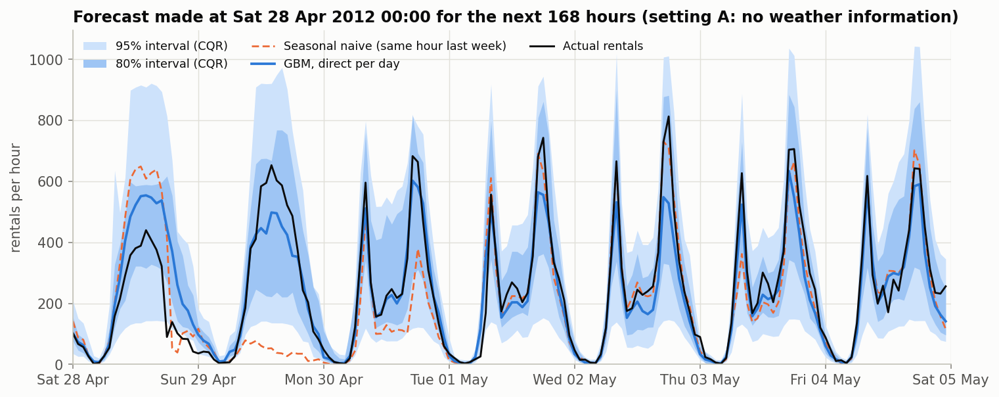
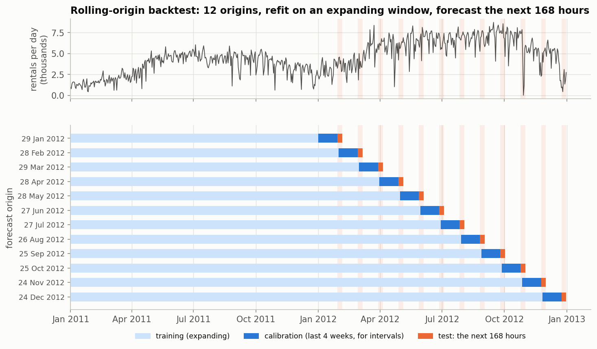
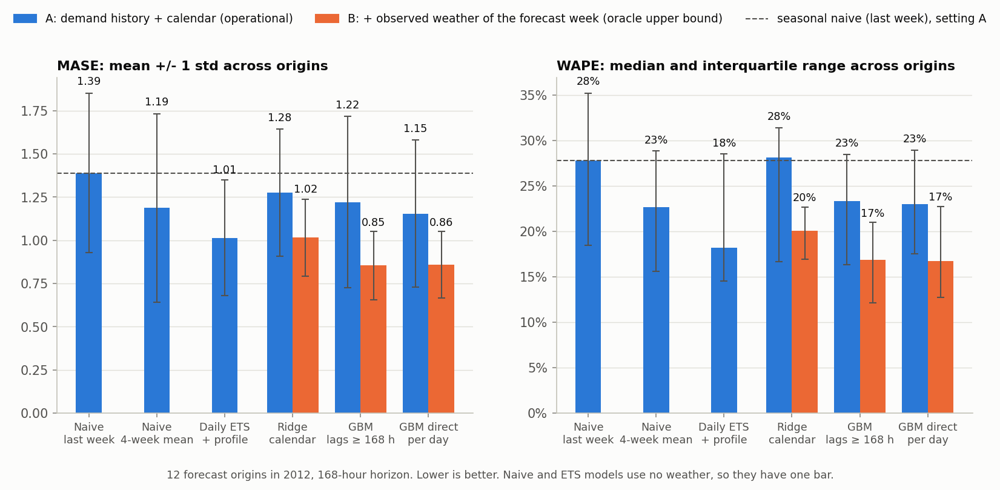
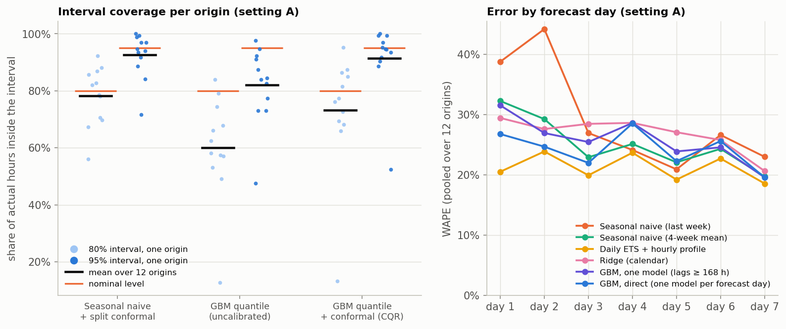

# Demand Forecasting Backtest (`demandcast`)

Demand forecasting evaluated the way it is used: rolling-origin backtesting, honest baselines,
leakage-safe features and calibrated prediction intervals, on real hourly bike-sharing demand.

[](https://github.com/faiqrasulov/demand-forecasting-backtest/actions/workflows/ci.yml)

[](LICENSE)

## Key results

Task: at midnight on 12 forecast origins spread over 2012, forecast the next **168 hours** of
Capital Bikeshare rentals, refitting every model on all data before the origin. Numbers are
means over the 12 origins (± std) from `make run`, stored in
[`reports/metrics.json`](reports/metrics.json).

| | Seasonal naive (last week) | Daily ETS + hourly profile | Gradient boosting, direct |
|---|---:|---:|---:|
| **A: history + calendar** (what is known at the origin): MASE | 1.389 ± 0.461 | **1.015 ± 0.335** | 1.155 ± 0.427 |
| A: pooled WAPE (total abs. error / total demand) | 29.0% | **21.2%** | 24.1% |
| **B: + observed weather** (a perfect weather forecast): MASE | 1.389 ± 0.461 | 1.015 ± 0.335 | **0.858 ± 0.193** |
| B: pooled WAPE | 29.0% | 21.2% | **18.0%** |

- **In the operational setting a classical model wins.** Holt-Winters on daily
  totals, split into hours by a recent hourly profile, has lower MAE than the seasonal naive
  at **12 of 12** origins (48.7 vs 66.6 rentals/hour). Gradient boosting beats the naive at
  9 of 12, and is roughly tied with a 4-week seasonal average (MASE 1.188).
- **Weather is the big lever, and it is not available.** With the *observed* weather of the
  forecast week, the direct boosting model's MAE drops by 22.4% on average and improves at all
  12 origins (single-model boosting: 26.7%). That gap is an upper bound on what a weather
  forecast could buy, not an accuracy anyone can deploy.
- **Calibration matters more than the interval model.** Uncalibrated quantile boosting covers
  only **60.1%** of hours with its "80%" interval and 82.1% with its "95%" interval.
  Conformalized quantile regression (CQR) raises this to **73.2% / 91.4%** (median origin
  76.8% / 94.6%) at 2.8x less width than conformal intervals around the seasonal naive at 95%
  (307 vs 859 rentals/hour).
- **One week breaks every model.** On 24-26 December 2012 demand was 441-1,013 rentals/day,
  against a mean of 4,927/day over 10-21 December. Christmas-week WAPE was 133% to 181% for
  the three models above, and the CQR 80% interval covered 13% of hours.



*The origin with the median WAPE for direct gradient boosting (a typical week, not the best
one). Setting A: the forecast uses only demand history and the calendar.*

## Problem & why it matters

Bike-share operators move bikes between stations, schedule rebalancing crews and plan
maintenance from short-term demand forecasts; retailers and FMCG suppliers do the same with
store staffing, replenishment and inventory. Those decisions depend on two things: how
accurate the forecast is **at the time it is made**, and how wrong it can be (safety stock and
staffing buffers are sized from the uncertainty, not from the point forecast).

The usual evaluation, one train/test split and a metric, overstates both:

1. **One split is a lottery.** In this backtest the same model's weekly WAPE ranges from
   11.6% to 181% depending on the week tested (direct gradient boosting, setting A).
2. **Leakage hides in features.** A lag-1 feature or "today's temperature" looks harmless in
   a random split but is not known a week ahead.
3. **Baselines are skipped.** Seasonal naive forecasts are free, and here a 4-week seasonal
   average was as accurate as single-model gradient boosting.
4. **Intervals are not checked.** A nominal 80% interval that covers 60% of outcomes leaves
   demand outside the planned buffer twice as often as planned (40% of hours instead of 20%).

## Approach



**Forecast task.** Origins are at 00:00 every 30 days from 29 Jan to 24 Dec 2012 (12 origins;
the 30-day step rotates the weekday of the origin). At each origin every model is refitted on
all hours before it (expanding window: 9,432 training hours at the first origin, 17,352 at the
last) and forecasts the next 168 hours. There is no data latency (`gap = 0`); the splitter
supports one. Two information settings:

- **A (operational):** demand history + calendar (hour, weekday, public holidays, working
  day). All of these are known at the origin.
- **B (oracle weather):** A + the *observed* temperature, humidity, wind and weather situation
  of the forecast week. Weather in this dataset is observed, not forecast, so B is an upper
  bound on what a perfect weather forecast could add.

**Leakage controls**, each enforced in code and tested:

- The splitter only trains on hours strictly before `origin - gap`
  ([`backtest.py`](src/demandcast/backtest.py)).
- At each origin the target is set to NaN from the origin onwards before any model sees the
  data (`mask_future`), and in setting A the weather columns are physically dropped.
- Lag features refuse any lag shorter than the horizon they serve
  ([`features.py`](src/demandcast/features.py)).
- Boosting runs with early stopping off, because its random validation split would put
  future hours into training.
- Every model is tested end to end: its forecasts must be bit-for-bit identical when all
  demand at and after the origin is replaced by noise.

**Data handling.** The OpenML copy of the dataset has no date column, so timestamps are rebuilt
from row order and validated against the year, month and weekday columns (all 17,379 rows
match). 165 of the 17,544 hours are missing from the source: mostly 2-5 am hours (presumably
no rentals; the source has no zero counts), plus outages (January 2011 snow storms, hurricanes Irene and Sandy). They enter lags
as zeros but are never used as training targets and never scored.

**Models** ([`models.py`](src/demandcast/models.py)):

| Model | What it does | Why |
|---|---|---|
| Seasonal naive | Same hour one week earlier | The benchmark every model must beat; also the MASE scale |
| Seasonal naive, 4 weeks | Mean of the same hour over the last 4 weeks | Averages out one-off weeks (rain, holidays) at no cost |
| Daily ETS + hourly profile | Holt-Winters (damped additive trend, multiplicative weekly seasonality, statsmodels) on daily totals; split into hours by the hour-of-day shares of the last 8 weeks, separately for working and non-working days | Hourly ETS cannot hold two seasonalities (24 h and 168 h). The top-down split keeps ETS on the daily series it is good at; the hourly profile is very stable and the day type is known in advance |
| Ridge, calendar | Ridge on log1p(demand): periodic cubic splines of hour-of-day fitted separately for working and non-working days, weekday dummies, holiday, annual Fourier terms, linear trend (+ temperature spline, humidity, wind, weather dummies in B) | A transparent regression baseline; shows what calendar structure alone explains |
| Gradient boosting, lags ≥ 168 h | `HistGradientBoostingRegressor`, Poisson loss, calendar + lags at 1-4 weeks, 8 days, trailing day/week means (+ weather in B) | Direct strategy with one model: every input is at least a week old, so one model serves all 168 hours with no recursion |
| Gradient boosting, direct | Seven Poisson models; the model for forecast day *d* uses only lags ≥ 24·*d* hours | The textbook direct strategy: day 1 may use yesterday, day 7 may not. No recursion, so no error feedback, and leakage is easy to test |

**Metrics** ([`metrics.py`](src/demandcast/metrics.py)): MAE, RMSE, WAPE, and MASE
(Hyndman & Koehler 2006), scaled by the in-sample MAE of the one-week seasonal naive on each
origin's training window. All are computed per origin and summarised as mean ± std across
origins, plus median, interquartile range and pooled WAPE. MASE above 1 does not mean "worse
than naive" here: the scale comes from the full history, which is dominated by lower-demand
2011 (142 vs 233 mean rentals/hour in 2012). The fair comparison is the out-of-sample seasonal
naive at 1.389.

**Prediction intervals** ([`intervals.py`](src/demandcast/intervals.py)), each calibrated on
the 4 weeks (672 hours) before the origin:

- *Seasonal naive + split conformal:* symmetric conformal quantile of the absolute residuals.
- *Quantile boosting:* boosting with pinball loss at the 10/90% and 2.5/97.5% quantiles,
  trained on data before the calibration window and **not** calibrated.
- *CQR* (Romano, Patterson & Candès 2019): the same quantile models, shifted by a conformal
  quantile of how far calibration actuals fell outside them (a negative shift narrows bounds
  that are too wide).

Conformal scores are computed on the log1p scale, so the correction is multiplicative. A
diagnostic on 2011 data only, before the first origin, supports this: binned by forecast
level, the 90th
percentile of absolute seasonal-naive residuals varies by a factor of 20.8 across levels on the
raw scale, 3.4 on the square-root scale and 1.9 on log1p (`scale_diagnostic_before_first_origin`
in `metrics.json`).

**Tests** (52, under 10 s, no network): the splitter never trains at or after the origin
(with gaps and calibration windows); lag features are invariant to demand inside the horizon,
and the test also checks that the hour just after the horizon *does* change; every model is
invariant to future demand; the end-to-end pipeline gives identical forecasts when all demand
after the first origin is corrupted; MAE/RMSE/WAPE/MASE against closed-form answers and
scikit-learn; seasonal naive is exact on a periodic series; split conformal hits the exact
finite-sample coverage `ceil((n+1)(1-a))/(n+1)` on i.i.d. data; CQR repairs quantile bands that
are too narrow or too wide; timestamp rebuilding and gap filling; and a pipeline smoke test on a
synthetic hourly series.

**The model set.** Two boosting models are reported: one with single lags ≥ 168 h, and a
per-day direct variant that can use the most recent days' level, which is where daily ETS gets
its advantage. The per-day variant was added after the first one lost to daily ETS on the 2012
origins, so its comparison with ETS is not a clean out-of-sample test. Hyperparameters are
fixed in the code and are not tuned by `make run`.

## Results

### Point forecasts



| Setting | Model | MASE mean ± std | MASE median | WAPE median (IQR) | Pooled WAPE | MAE | RMSE | Beats naive (MAE) |
|---|---|---:|---:|---:|---:|---:|---:|---:|
| A | Seasonal naive, last week | 1.389 ± 0.461 | 1.355 | 27.8% (18.4-35.2%) | 29.0% | 66.6 | 110.9 | - |
| A | Seasonal naive, 4-week mean | 1.188 ± 0.545 | 1.027 | 22.6% (15.6-28.9%) | 25.0% | 57.2 | 90.2 | 9/12 |
| A | **Daily ETS + hourly profile** | **1.015 ± 0.335** | **0.959** | **18.2% (14.5-28.5%)** | **21.2%** | **48.7** | **76.5** | **12/12** |
| A | Ridge, calendar | 1.276 ± 0.368 | 1.146 | 28.1% (16.6-31.4%) | 26.7% | 61.1 | 94.1 | 7/12 |
| A | Gradient boosting, lags ≥ 168 h | 1.221 ± 0.495 | 1.101 | 23.3% (16.3-28.5%) | 25.7% | 58.7 | 90.1 | 8/12 |
| A | Gradient boosting, direct | 1.155 ± 0.427 | 1.050 | 23.0% (17.6-28.9%) | 24.1% | 55.4 | 86.4 | 9/12 |
| B | Ridge, calendar + weather | 1.016 ± 0.222 | 0.983 | 20.1% (16.9-22.6%) | 21.4% | 48.6 | 75.1 | 9/12 |
| B | **Gradient boosting, lags ≥ 168 h + weather** | **0.854 ± 0.197** | **0.821** | 16.9% (12.1-21.0%) | **17.9%** | **40.9** | 63.2 | 12/12 |
| B | Gradient boosting, direct + weather | 0.858 ± 0.193 | 0.847 | **16.7% (12.7-22.7%)** | 18.0% | 41.0 | 63.2 | 12/12 |

MAE and RMSE are in rentals per hour (2012 mean: 233). The naive and ETS models use no weather,
so their setting-B numbers equal setting A.

Interpretation:

- **Setting A: the daily ETS wins on every summary statistic** and on every forecast day, by
  the widest margin on day 1: pooled WAPE 20.5%, against 26.7% for direct boosting, 31.5% for
  single-model boosting and 38.7% for the seasonal naive. Daily Holt-Winters reacts to the level
  of the last few days, and at the daily grain that level carries weather persistence and the
  2012 growth trend.
- **Direct beats single-model boosting** (MASE 1.155 vs 1.221) because day-1 to day-3 models may
  use the last days. From day 4 on the two are close, as expected.
- **Ridge on calendar alone is weak (1.276)**: it has no way to know whether this week is warm.
  Adding the observed weather cuts its MAE by 17.7% on average, improving 10 of 12 origins.
- **Weather is worth more than any model choice.** Single-model boosting goes from 1.221 to
  0.854 with oracle weather (MAE -26.7% on average, all 12 origins improved). In B, both
  boosting variants clearly beat the setting-A champion; the calendar ridge with weather only
  ties it (MASE 1.016 vs 1.015).
- **Error concentrates in the commuting peaks.** For direct boosting in A, mean absolute error
  is 136 rentals at 18:00 and 3 at 04:00 (`mae_by_hour_of_day`).

### Prediction intervals



| Setting | Method | 80%: coverage mean ± std (median) | 80%: width | 95%: coverage mean ± std (median) | 95%: width |
|---|---|---:|---:|---:|---:|
| A | Seasonal naive + split conformal | 78.2% ± 10.5% (80.3%) | 262 | 92.5% ± 8.0% (94.3%) | 859 |
| A | Quantile boosting, uncalibrated | 60.1% ± 18.3% (60.3%) | 116 | 82.1% ± 13.5% (84.2%) | 219 |
| A | **Quantile boosting + CQR** | 73.2% ± 20.9% (76.8%) | 162 | 91.4% ± 12.8% (94.6%) | 307 |
| B | Quantile boosting, uncalibrated | 60.8% ± 15.0% (62.2%) | 98 | 83.3% ± 11.6% (86.0%) | 185 |
| B | **Quantile boosting + CQR** | 74.8% ± 14.3% (76.3%) | 135 | 92.2% ± 8.4% (94.3%) | 249 |

Width is the mean interval width in rentals per hour.

- **Raw quantile models are overconfident**, about 20 points below nominal at 80%. Pinball-loss
  boosting fits its training data closely, and the test week lies 4-5 weeks after its training
  window ends.
- **CQR fixes most of the gap at a modest width cost**: at the median origin it is within about
  3 points of nominal at both levels. Its mean is pulled down by the Christmas week (13% / 52%
  coverage) and by three origins at 66-69% for the 80% interval (late February, the Sandy week
  and late November).
- **The seasonal naive interval is calibrated but not useful at 95%**: 859 rentals/hour of
  width against a mean demand of 233. Conformal prediction guarantees coverage, not sharpness;
  sharpness has to come from a model of the conditional spread (the quantile models).
- Coverage still falls short of nominal on average because the guarantee assumes the
  calibration month and the test week are exchangeable. They are not under seasonal drift and
  holidays.

### What did not work

- **Christmas week (origin 24 Dec 2012).** Demand fell from a mean of 4,927 rentals/day on
  10-21 December to 920, 1,013 and 441 on 24, 25 and 26 December. Every model over-forecasts
  badly (WAPE 133% to 217% across the six setting-A models). The only similar
  example in training is Christmas 2011, and the holiday flag marks only 25 December. A real
  system needs an event calendar (holiday *periods*, school breaks) or a planner override; adding
  one after seeing this week would have been tuning on the test set.
- **Hurricane Sandy (origin 25 Oct, 22 rentals on 29 Oct).** A shutdown that no demand
  or calendar feature can anticipate. The week is kept in the backtest, but the hours the
  source does not record during the shutdown are not scored (see Data handling), so the error
  of every model in this week is understated.
- **CQR at 80% averages 73.2%, not 80%.** See above. Adaptive conformal inference (Gibbs &
  Candès 2021) is the natural next step.

## Lessons

1. **Start with seasonal naive, then a 4-week seasonal average.** The second costs nothing and
   was as good as single-model gradient boosting here (MASE 1.188 vs 1.221).
2. **Match the information set to the decision.** Using observed weather would have reported
   MASE 0.858 for a direct boosting setup whose honest accuracy is 1.155. The difference (MAE
   22.4% lower on average) is the value of a perfect weather forecast, a useful upper bound
   when deciding whether to buy one.
3. **Top-down can beat direct hourly models when the shape is stable.** Forecasting the daily
   total with a classic method and distributing it by a recent hourly profile won the
   operational setting, because the level, not the intraday shape, is what is hard to predict.
4. **Evaluate intervals, then calibrate them.** Uncalibrated quantile models looked sharp and
   were wrong 40% of the time at the 80% level.
5. **Report the distribution across origins, not just the mean.** One holiday week (WAPE
   133-181% for the three headline models) dominates the mean WAPE; the median, the
   interquartile range and the pooled WAPE tell a steadier story.

## Quickstart

```bash
git clone https://github.com/faiqrasulov/demand-forecasting-backtest.git
cd demand-forecasting-backtest
make install          # pip install -e ".[dev]"
make run              # download data, 12-origin backtest, settings A and B -> reports/ (~2.5 min)
make test             # 52 tests, under 10 s, no network
```

```python
from demandcast.data import load_bike_hourly
from demandcast.pipeline import BacktestConfig, run_backtest
from demandcast.evaluate import point_summary, interval_summary

df = load_bike_hourly("data")                       # regular hourly grid, 2011-2012
result = run_backtest(df, BacktestConfig(n_origins=3))
point_summary(result)["A"]["daily_ets"]["mase"]      # {'mean': ..., 'std': ..., ...}
```

## Project structure

```
src/demandcast/
  data.py       download (OpenML, UCI fallback), timestamp rebuild, regular hourly grid
  backtest.py   rolling-origin splitter (expanding window, gap, calibration window)
  features.py   calendar features, leakage-guarded lag features, ridge design matrix
  models.py     seasonal naive, daily ETS + profile, ridge, Poisson/quantile boosting, direct
  intervals.py  split conformal and conformalized quantile regression
  metrics.py    MAE, RMSE, WAPE, MASE, coverage, width
  pipeline.py   two-setting backtest with target masking at each origin
  evaluate.py   per-origin metrics, summaries, error profiles, scale diagnostic
  figures.py    the four report figures
  cli.py        `demandcast download` / `demandcast run`
reports/        metrics.json and figures written by `make run`
tests/          52 pytest tests on synthetic data
```

## Limitations & next steps

- **One city, one series, two years.** Twelve origins give a useful spread but wide error bars;
  the model ranking in setting A is clear for ETS vs the naive (12/12 origins) and much less
  clear among the middle models.
- **No real weather forecasts.** Setting B uses observed weather. The realistic middle ground,
  archived numerical weather forecasts or observed weather with noise that grows with the
  horizon, would show how much of the 22-27% oracle gain survives.
- **Holidays are single-day flags.** An event calendar with holiday periods would target the
  Christmas failure directly. It should be validated on the 2011 holidays, not 2012.
- **Intervals are marginal, not conditional.** Coverage is for all hours together. Peak hours
  and nights may be covered differently; Mondrian (per-hour-group) conformal or adaptive
  conformal would address this. The intervals are also not reconciled with the daily ETS model.
- **Hyperparameters are defaults**, deliberately not tuned on the test year. A nested
  rolling-origin search on 2011 would be the clean way to tune them.
- **Next steps:** global models across stations (the hierarchical version of this problem),
  forecast reconciliation between daily and hourly levels, and probabilistic scoring (pinball
  loss / CRPS) next to coverage and width.

## Data & references

**Data:** Bike Sharing Dataset (hourly), Capital Bikeshare, Washington D.C., 2011-2012, with
weather and holiday information. Downloaded at runtime from OpenML
([data_id 42712](https://www.openml.org/d/42712)), with the official
[UCI archive](https://archive.ics.uci.edu/dataset/275/bike+sharing+dataset) as fallback. Licensed
under [CC BY 4.0](https://creativecommons.org/licenses/by/4.0/) by the UCI Machine Learning
Repository (DOI: 10.24432/C5W894). The data are not redistributed in this repository.

- Fanaee-T, H. & Gama, J. (2013). *Event labeling combining ensemble detectors and background
  knowledge.* Progress in Artificial Intelligence 2, 113-127. (dataset)
- Tashman, L. J. (2000). *Out-of-sample tests of forecasting accuracy: an analysis and review.*
  International Journal of Forecasting 16(4). (rolling-origin evaluation)
- Hyndman, R. J. & Koehler, A. B. (2006). *Another look at measures of forecast accuracy.*
  International Journal of Forecasting 22(4). (MASE)
- Hyndman, R. J. & Athanasopoulos, G. (2021). *Forecasting: Principles and Practice*, 3rd ed.
  OTexts. (exponential smoothing, seasonal naive, top-down forecasting)
- Ben Taieb, S., Bontempi, G., Atiya, A. & Sorjamaa, A. (2012). *A review and comparison of
  strategies for multi-step ahead time series forecasting based on the NN5 forecasting
  competition.* Expert Systems with Applications 39(8). (direct vs recursive strategies)
- Romano, Y., Patterson, E. & Candès, E. (2019). *Conformalized quantile regression.* NeurIPS.
- Lei, J., G'Sell, M., Rinaldo, A., Tibshirani, R. & Wasserman, L. (2018). *Distribution-free
  predictive inference for regression.* JASA 113(523). (split conformal)
- Gibbs, I. & Candès, E. (2021). *Adaptive conformal inference under distribution shift.* NeurIPS.
- Ke, G. et al. (2017). *LightGBM: a highly efficient gradient boosting decision tree.* NeurIPS.
  (the histogram boosting that scikit-learn's `HistGradientBoostingRegressor` follows)

## License

MIT, see [LICENSE](LICENSE).
